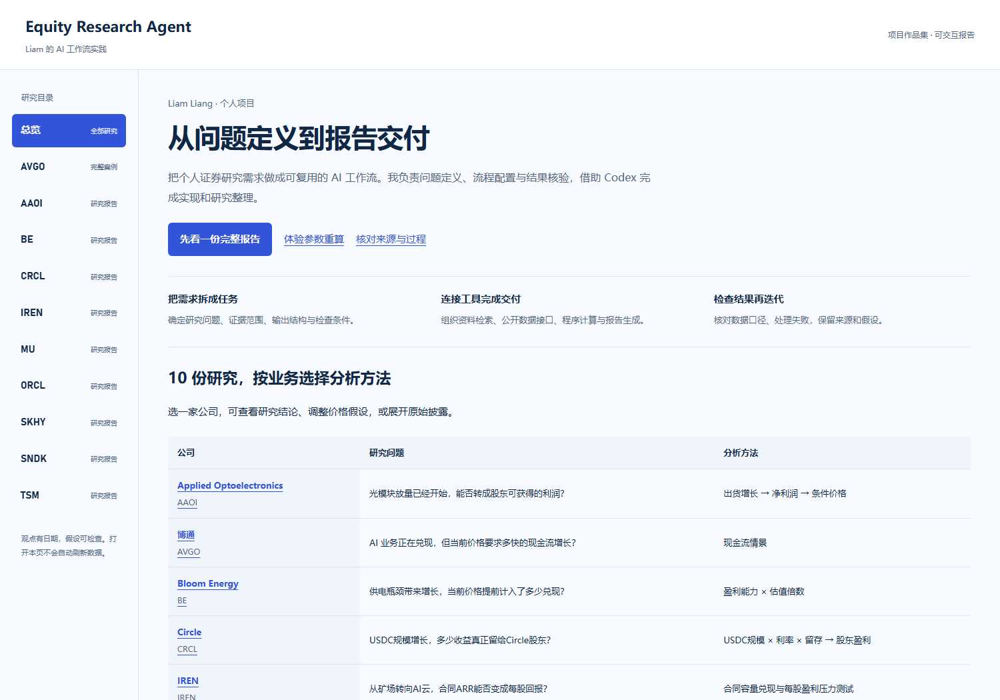
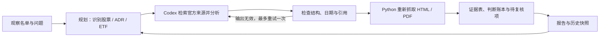

# Equity Research Agent

把证券研究需求做成可复用的 AI 工作流：获取资料、组织证据、执行计算，交付可以核查的报告。

## 直接看效果

### [打开交互式报告，无需安装](https://liamliang0.github.io/equity-research-agent/)

覆盖 **10 家公司**。可以切换研究、拖动参数重算，或点开原始披露核对依据。

[](https://liamliang0.github.io/equity-research-agent/)

想快速了解项目，可以先看[博通完整报告](https://liamliang0.github.io/equity-research-agent/#company-AVGO)，再选“价格与假设”体验计算，或选“来源与过程”核对证据。

## 我在项目中做了什么

- **定义问题：**从个人研究需求出发，确定比较什么、需要哪些来源，以及什么结果算完成。
- **配置流程：**借助 ChatGPT / Codex，把资料检索、公共数据接口、计算与报告交付连接起来。
- **核验和迭代：**检查日期、季度与累计口径、币种和引用；根据实际取数、PDF读取和模型计算的失败修改流程。

代码实现与研究整理由 Codex 辅助。项目重点是问题拆解、工具配置、输出验收与持续改进，不是自研底层模型。

## 真实迭代记录

从最初的存储研究需求，逐步加入可比期间检查、公开数据接口、分业务的价格实验和10家公司报告；再根据实际查看反馈补上导航、可见项目链接与交互演示。[查看代码变更](https://github.com/liamliang0/equity-research-agent/commits/main/)或[设计与迭代记录](docs/design-and-iteration.md)。

## 可以核实的成果

| 想看什么 | 从哪里看 |
|---|---|
| 最终交付 | [10家公司交互式报告](https://liamliang0.github.io/equity-research-agent/) |
| 实际输入与假设 | [公司研究配置](examples/company-profiles.example.json)、[博通现金流案例](examples/complete-case.json) |
| 数据与计算 | [接口快照](examples/complete-case-data.json)、[多公司计算记录](examples/multi-company-studies.json) |
| 检查与取舍 | [自动检查](https://github.com/liamliang0/equity-research-agent/actions/workflows/tests.yml)、[研究质量与边界](docs/research-quality.md) |

不同业务采用不同方法：周期盈利、现金流、收入兑现、储备收益与ADR报价诊断。未来增长和估值参数是显式假设，研究有日期，未展示账户金额、实际仓位或投资收益。

<details>
<summary>展开实现方式、运行命令和历史样例</summary>

## 解决什么问题

对证券的研究容易停留在一次问答：看完很多新闻，却说不清当前判断依据是什么、哪里仍未知、什么证据会改变观点。本项目将观察名单和研究问题变成可重复执行的流程，保留支持证据、反例、失效条件及运行历史。HTML 只是可选阅读格式，核心不依赖网页。



## 已实现

- **真实 Agent 调用：**使用已登录的 Codex CLI 检索与分析；运行日志必须出现实际 web search，不能用静态文字冒充联网研究。
- **真实接口取数：**HTTP读取报价、XBRL财报和国债曲线，按季度/累计/年度保留口径；结构化API证据可进入第二轮分析。仅刷新数据不会冒充重新生成AI观点。
- **可配置证券：**支持1–30个观察对象，分别处理经营公司、ADR 和 ETF；不是写死几个 ticker。首次记录不会伪装成趋势。
- **质量检查：**核验日期、来源域名、证券覆盖及引用关系；失败保留错误与历史结果，不能静默变成“中性”。
- **证据与复盘：**逐条生成 `evidence.csv`、`thesis-ledger.json`、`review.md` 和文件指纹；下一轮对照前次判断。
- **低成本重查：**来源获取失败后可只重做网页/PDF核验，不必重新调用模型。
- **明确输入的计算账本：**用 Decimal 复算比例、增幅、差值或求和，保存输入与来源。不会猜出所有模型计算的输入，也不声称自动审计全部数字。
- **私人输入最小化：**观察名单加载只保留证券标识与研究配置，不把份额、成本、盈亏等附加字段放入模型提示。私人名单与结果默认不发布。

**公开演示覆盖 10 家公司，首页可切换全部研究。仅发布公开企业资料与研究假设，不含账户金额、仓位、成本或盈亏。** 将 SEC 财报的年度、年内累计与可比累计衔接为 TTM，检查现金流、股权薪酬和债务，再计算条件情景与价格隐含增长。AAPL/SPY 旧样例保留为早期工作流记录，不代表新版主案例。没有虚构生产用户、投资收益或金融专业资质。

## 快速运行

需要 Python 3.10+、已安装且登录的 Codex CLI。真实研究会使用 Codex 额度；离线测试和 `--plan-only` 不调用模型。

```bash
python -m pip install -r requirements.txt
codex login
python market_data.py --output output/data
python render_case.py
# 重新联网研究及第二轮审阅（需要 Codex 额度）
python showcase.py --watchlist watchlist.case.example.json --case-profile examples/avgo-case-profile.json --company-profiles examples/company-profiles.example.json --output output/public-case
python research_agent.py --plan-only
python research_agent.py --watchlist watchlist.example.json
```

Windows 可双击 `setup.cmd` 安装项目内环境，再运行 `showcase.cmd` 生成并打开新版案例；`run.cmd` 保留原研究流程。不修改全局配置，不要求复制 API Key。PDF 检查使用 pypdf；HTML 与其他流程使用标准库。Codex 采用只读沙箱运行。

### 当前案例怎样读

先在总览选择公司，读结论与三条证据，再切换“价格与假设”，调整增长、WACC、永续增长或现金流起点，最后在“来源与过程”核查原始披露与接口记录。页面离线可读，不需要前端服务器。

- 用“上一财年 + 本年累计 − 上年可比累计”构造 TTM，不将九个月数字误当全年。最近季度现金流由累计差额取得。
- 从经营现金流扣资本支出、股权薪酬经济成本，再加税后现金利息代理；这是显式简化的 FCFF 代理，缺少租赁、少数股东等完整调整。
- 情景、反推增长和敏感性由 Python 计算；浏览器重算与 Python 核对。TTM 和最近季度年化都展示，后者只是起点敏感性，不是预测。
- ERP、Beta、正常化税率及未来增长属于分析假设；没有机构共识或情景概率。终值占比显式展示，不把模型输出说成精确目标价。

新增标的按业务分流：周期盈利、交付与利润、储备业务及ADR报价诊断各有独立公式，不能全部套博通。详见[多标的研究与模型分流](docs/company-research.md)。

`python render_case.py` 会重新读取公共接口并计算，**不会重新生成 AI 观点**。研究叙述保留原日期。当前完整案例由本次交互式 Codex 研究、原披露核对及程序计算组成，不冒充一次新的自动 CLI 研究成功。`showcase.py` 则可运行完整两轮流程；网络或认证失败会明确报错。

视觉采用 [Anthropic frontend-design](https://github.com/anthropics/skills/blob/main/skills/frontend-design/SKILL.md) 的设计指导，按“结论—证据—条件—过程”组织；没有引入其交易功能或任何前端运行依赖。详见 [研究质量与边界](docs/research-quality.md)。

### 使用自己的名单

基础研究命令默认 AAPL/SPY，新版完整案例使用 watchlist.case.example.json 的 AVGO；两者都是公开演示配置。私人持仓研究使用独立的本地名单和输出目录：

```bash
python showcase.py --watchlist private/watchlist.json --output private/results --private
```

`--private`在页面标注仅本地保存；它不是自动脱敏或访问控制，不能把该目录发布到Pages。打开旧页面不刷新数据，已有名单也不代表实时券商同步。自动CLI失败时不得把交互式人工补齐标成自动运行成功。

按 `watchlist.example.json` 填写 `id/name/kind/domains/questions`；`kind` 支持 `equity/adr/etf`。把真实输入放在 gitignored 的 `private/` 或仓库外，先检查官方域名。

```bash
python research_agent.py --watchlist private/watchlist.json --output private/results --question "这些公司的增长来自量价、产品结构还是一次性因素？"
python research_agent.py --watchlist private/watchlist.json --output private/results --recheck private/results/latest-ai-research.json
```

已读取的券商快照可以用于生成本地证券名单，但本仓库没有券商登录、订单工具或自动同步。读取账户的连接器与研究运行时分开；不把持仓字段交给研究模型，也不上传账户导出。

### 复算公开样例中的指定数字

```bash
python calculations.py --input examples/calculation-inputs.json --output output/calculation-ledger.json
```

这四项复算的输入由公开来源手工整理；其中 SPY 只复算前三项小计，不包括前十大总和。**代码算对输入，不等于输入和经济口径已自动审计。**

## 我的贡献与 AI 的贡献

这是个人 AI 工作流实践项目。本人提出研究需求、定义证券分流与输出要求、配置工具与核验规则、检查真实失败案例，并根据实际结果迭代。Codex 辅助实现代码、测试和研究分析；成熟 Agent 运行时提供工具调用。底层模型与框架不是我自研。

看这个项目时，更值得看的是需求如何变成可执行流程、输出怎样被检查、失败如何处理，而不是代码行数或“多 Agent”标签。反方分析与支持分析来自同一次研究调用，并非独立专家共识。

## 借鉴与边界

对照了 TradingAgents、AI Hedge Fund、FinRobot 和 Mira 的实际文档及实现，采用适合小型研究工作流的做法，见 [设计取舍与来源](docs/inspiration.md)。没有直接搬用这些仓库的实现，也没有安装它们的交易系统。

- 原文片段匹配、引用检查和文件指纹是程序检查，**不是完整事实核查或独立审计**。
- 动态页面、403、文件过大或扫描PDF可能留下证据缺口；报告必须显示待复核。
- 只做研究；不接订单、不承诺收益。可计算显式假设下的普通股模型价值，缺少数据不猜目标价。ETF/ADR暂不进入该估值模块。
- 公开样例是固定日期快照，不是实时数据。后续学习与行业变化可能使判断过时。

## 验证

```bash
python -m unittest discover -p "test*.py" -v
```

GitHub Actions 仅运行离线测试和规划，不使用用户账户或模型额度。真实演示的运行编号、来源检查及已知限制在 [run-summary.json](examples/run-summary.json)，不是用模拟测试冒充实际研究。


</details>
