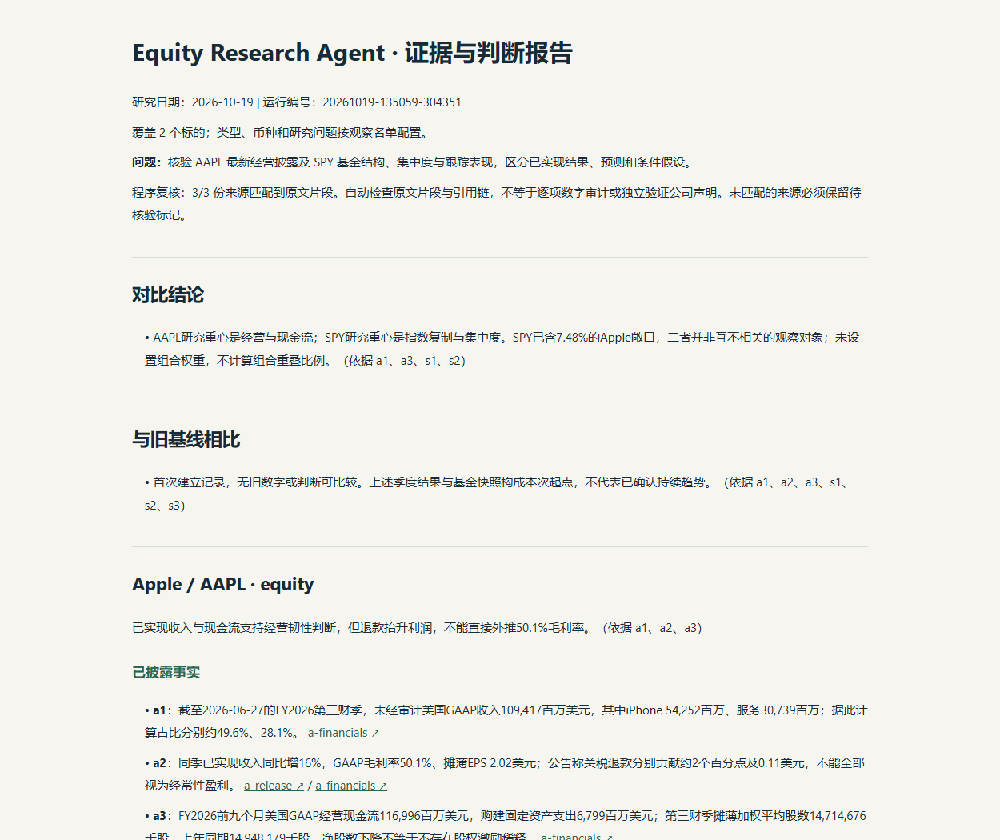
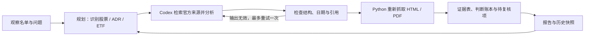

# Equity Research Agent

**把研究问题交给 AI，把来源与判断留下来。** An on-demand, evidence-tracked research workflow for equities, ADRs and ETFs, built with Codex CLI and Python.

**先看结果：** [真实报告样例](examples/report.md) · [运行与核验记录](examples/run-summary.json) · [证据表](examples/evidence.csv) · [判断账本](examples/thesis-ledger.json) · [程序审查](examples/review.md)



## 解决什么问题

对证券的研究容易停留在一次问答：看完很多新闻，却说不清当前判断依据是什么、哪里仍未知、什么证据会改变观点。本项目将观察名单和研究问题变成可重复执行的流程，保留支持证据、反例、失效条件及运行历史。HTML 只是可选阅读格式，核心不依赖网页。



## 已实现

- **真实 Agent 调用：**使用已登录的 Codex CLI 检索与分析；运行日志必须出现实际 web search，不能用静态文字冒充联网研究。
- **可配置证券：**支持1–30个观察对象，分别处理经营公司、ADR 和 ETF；不是写死几个 ticker。首次记录不会伪装成趋势。
- **质量检查：**核验日期、来源域名、证券覆盖及引用关系；失败保留错误与历史结果，不能静默变成“中性”。
- **证据与复盘：**逐条生成 `evidence.csv`、`thesis-ledger.json`、`review.md` 和文件指纹；下一轮对照前次判断。
- **低成本重查：**来源获取失败后可只重做网页/PDF核验，不必重新调用模型。
- **明确输入的计算账本：**用 Decimal 复算比例、增幅、差值或求和，保存输入与来源。不会猜出所有模型计算的输入，也不声称自动审计全部数字。
- **私人输入最小化：**观察名单加载只保留证券标识与研究配置，不把份额、成本、盈亏等附加字段放入模型提示。私人名单与结果默认不发布。

**公开演示用 AAPL / SPY，属于独立选择的演示对象，不是券商账户展示。** 样例记录初次PDF核验失败、修复后的重新核验，以及仍需人工复核的派生计算范围。没有虚构生产用户、投资收益或金融专业资质。

## 快速运行

需要 Python 3.10+、已安装且登录的 Codex CLI。真实研究会使用 Codex 额度；离线测试和 `--plan-only` 不调用模型。

```bash
python -m pip install -r requirements.txt
codex login
python research_agent.py --plan-only
python research_agent.py --watchlist watchlist.example.json
```

Windows 可双击 `setup.cmd` 安装项目内环境，再运行 `run.cmd`。不修改全局配置，不要求复制 API Key。PDF 检查使用 pypdf；HTML 与其他流程使用标准库。Codex 采用只读沙箱运行。

### 使用自己的名单

按 `watchlist.example.json` 填写 `id/name/kind/domains/questions`；`kind` 支持 `equity/adr/etf`。把真实输入放在 gitignored 的 `private/` 或仓库外，先检查官方域名。

```bash
python research_agent.py --watchlist private/watchlist.json --output private/results --question "这些公司的增长来自量价、产品结构还是一次性因素？"
python research_agent.py --watchlist private/watchlist.json --output private/results --recheck private/results/latest-ai-research.json
```

已读取的券商快照可以用于生成本地证券名单，但本仓库没有券商登录、订单工具或自动同步。读取账户的连接器与研究运行时分开；不把持仓字段交给研究模型，也不上传账户导出。

### 复算公开样例中的指定数字

```bash
python calculations.py --input examples/calculation-inputs.json --output output/calculation-ledger.json
```

这四项复算的输入由公开来源手工整理；其中 SPY 只复算前三项小计，不包括前十大总和。**代码算对输入，不等于输入和经济口径已自动审计。**

## 我的贡献与 AI 的贡献

这是个人 AI 工作流实践项目。本人提出研究需求、定义证券分流与输出要求、配置工具与核验规则、检查真实失败案例，并根据实际结果迭代。Codex 辅助实现代码、测试和研究分析；成熟 Agent 运行时提供工具调用。底层模型与框架不是我自研。

看这个项目时，更值得看的是需求如何变成可执行流程、输出怎样被检查、失败如何处理，而不是代码行数或“多 Agent”标签。反方分析与支持分析来自同一次研究调用，并非独立专家共识。

## 借鉴与边界

对照了 TradingAgents、AI Hedge Fund、FinRobot 和 Mira 的实际文档及实现，采用适合小型研究工作流的做法，见 [设计取舍与来源](docs/inspiration.md)。没有直接搬用这些仓库的实现，也没有安装它们的交易系统。

- 原文片段匹配、引用检查和文件指纹是程序检查，**不是完整事实核查或独立审计**。
- 动态页面、403、文件过大或扫描PDF可能留下证据缺口；报告必须显示待复核。
- 只做研究；不接订单、不承诺收益、不自动给出目标价。ETF/ADR与经营公司不能直接混排财务指标。
- 公开样例是固定日期快照，不是实时数据。后续学习与行业变化可能使判断过时。

## 验证

```bash
python -m unittest discover -p "test*.py" -v
```

GitHub Actions 仅运行离线测试和规划，不使用用户账户或模型额度。真实演示的运行编号、来源检查及已知限制在 [run-summary.json](examples/run-summary.json)，不是用模拟测试冒充实际研究。
